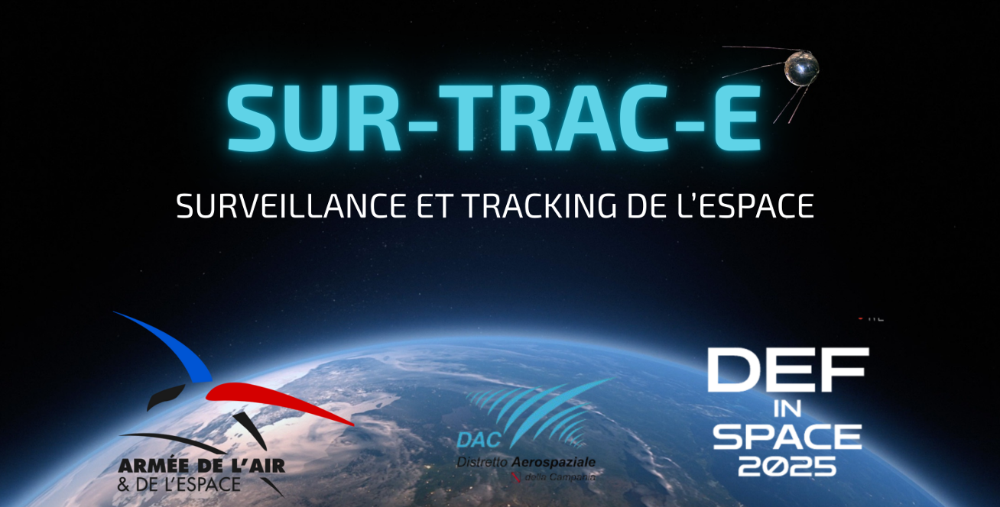
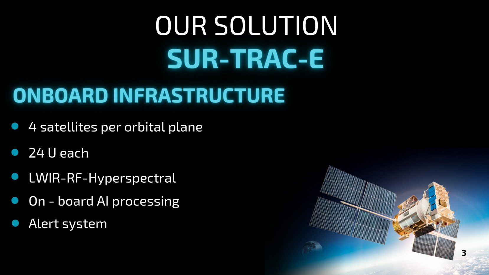
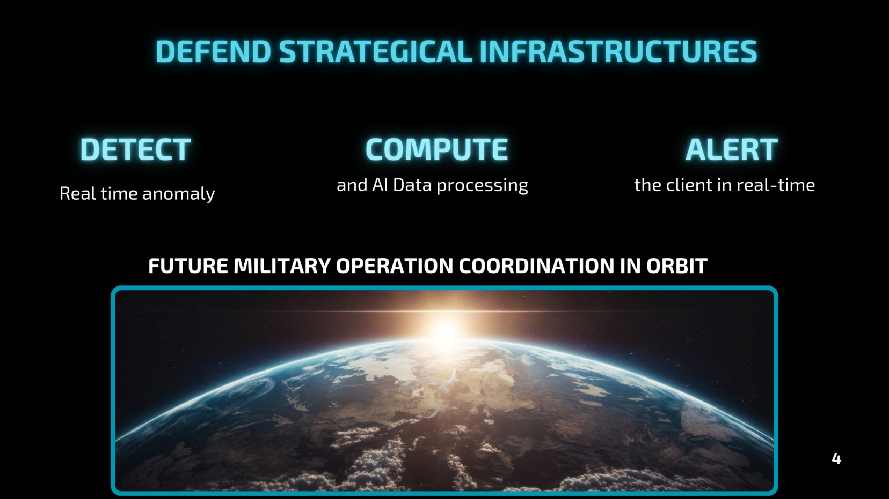
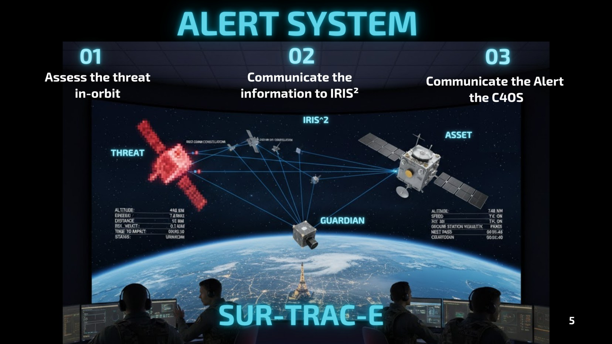
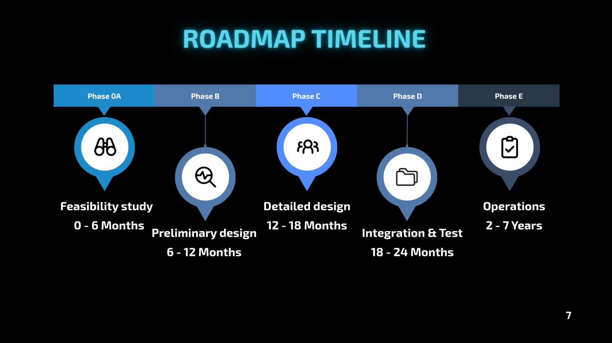
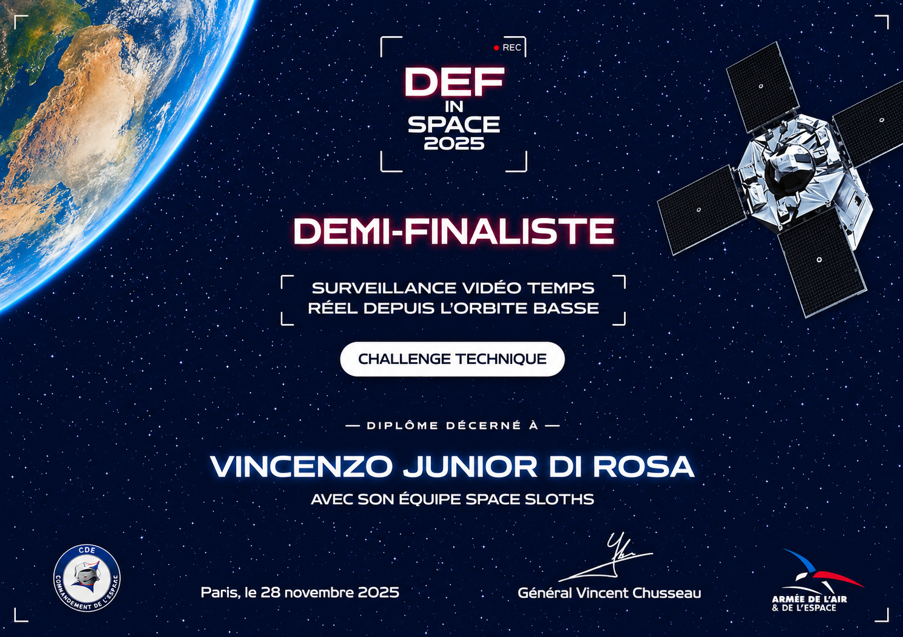

  

<h1 align="center">SUR-TRAC-E</h1>

<strong>AI-Assisted Space Surveillance & Tracking</strong> 
Space Systems Engineering Concept · DefInSpace 2025 · Team Space Sloths

<strong>Italian Technical Challenge Winner · International Semi-Finalist</strong>

> **Conceptual Mission Design** — SUR-TRAC-E is a space-surveillance system concept developed for DefInSpace 2025, exploring how a multi-sensor satellite constellation and onboard AI could support faster detection, assessment, and reporting of potentially anomalous orbital activity.

## Mission overview

**SUR-TRAC-E** (*Surveillance et Tracking de l'Espace*) explores a distributed, space-based approach to **Space Situational Awareness (SSA)** and the protection of strategic orbital assets. As satellite constellations expand, operators need to distinguish routine activity from potentially suspicious maneuvers, characterize objects of interest, and communicate relevant information rapidly.

Our proposal brings the first stages of surveillance and assessment **onboard a constellation of dedicated satellites**. Instead of relying exclusively on transmitting large volumes of raw observations for ground processing, SUR-TRAC-E combines complementary sensors and AI-assisted analysis to identify anomalies and prioritize actionable alerts.

**[View Project Presentation (PDF)](SurTracE%20presentation.pdf)**

## Proposed space segment

The competition architecture envisaged **24U spacecraft**, arranged as **four satellites per orbital plane**. The team's working constellation scenario considered **three orbital planes (12 satellites total)**, with deployment designed to be scalable.

Three complementary sensing modalities underpin the concept:

| Payload | Proposed purpose |
| --- | --- |
| **Hyperspectral imaging** | Detect and characterize objects or changes in the observed scene; provide an initial cue for further assessment. |
| **Long-wave infrared (LWIR)** | Add thermal information when examining anomalous behavior or activity. |
| **Radio-frequency (RF) sensing** | Observe RF signatures as an additional source of evidence for object characterization. |

The concept integrates these measurements with **onboard AI processing**, reducing dependence on continuous transmission of unfiltered sensor data.

## Operational concept — Detect · Compute · Alert

**1. Detect.** Observe an orbital region, identify an object or event of interest, and collect complementary sensor measurements.

**2. Compute.** Process observations onboard and compare estimated behavior and signatures with available reference information. Multi-sensor evidence helps distinguish nominal activity from cases requiring closer examination.

**3. Alert.** Generate a prioritized alert containing the relevant assessment and supporting observations, then route it toward the ground-side decision-making chain.

The alert architecture was conceived to support **timely decision-making** while limiting unnecessary data transfer. The slide illustrates the intended information flow and its relationship to wider space-security operations.

## Systems engineering considerations

Beyond the payload concept, our team examined the major system-level questions that determine whether such a service could be developed:

- **Coverage and scalability:** distribute satellites across orbital planes and expand the constellation in stages.
- **Sensor complementarity:** combine spectral, thermal and RF evidence rather than depend on a single observation channel.
- **Onboard processing vs. downlink:** prioritize high-value information while preserving the option to retrieve additional data.
- **Operational integration:** design an alert-oriented information flow that could support existing ground-based monitoring and command systems.
- **Feasibility:** frame a phased development roadmap, preliminary cost estimate and SWOT assessment.

## Development roadmap and preliminary economics

The pitch outlined a phased progression from **feasibility study** and **preliminary design**, through **detailed design**, **integration and testing**, to **operations**. The accompanying high-level business assessment estimated a **€39.5 million** program cost in the competition scenario. These figures describe the proposed mission plan, not actual expenditure or a completed deployment.

## DefInSpace 2025 — Competition outcome

Developed by **Space Sloths** for the **DefInSpace 2025 Technical Challenge**, SUR-TRAC-E won the **Italian selection** and advanced to the **international semi-finals in Paris on 28 November 2025**.

*International semi-finalist certificate — DefInSpace 2025.*

## My contribution and team

I contributed as **Strategic Researcher** and served as a **presenter and speaker during both the national and international competition stages**, communicating the team's mission concept, proposed architecture, and strategic rationale to the respective juries. The work was developed collaboratively by **Maria Mattiello, Pierluca De Felice, Raffaele Colamarino, Vincenzo Junior Di Rosa, and Corrado D'Urso**, with complementary responsibilities spanning payload, onboard computing, systems engineering, strategic research and mission analysis.

## Project status

**Conceptual mission architecture developed for a technical competition.** The repository presents the original proposal and selected pitch materials; it does not represent a deployed satellite system or flight-validated implementation.

## References

- [Distretto Aerospaziale della Campania — DefInSpace 2025](https://it.linkedin.com/posts/dac-distretto-aerospaziale-della-campania_talento-creativit%C3%A0-definspace2025-activity-7383039434528657408-FTGV)
- [Commandement de l'Espace — DefInSpace semi-finalists](https://fr.linkedin.com/posts/commandement-de-lespace_definspace-activity-7382830475980992512-tPxD)

*All technical figures reproduced here are from the team's original competition presentation. This repository documents the competition concept and credits the collective work of its contributors.*
